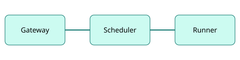

# Architecture overview

Atlas has three runtime components and one build component.

## Components

| Component | Role                               | Default port |
| --------- | ---------------------------------- | ------------ |
| Gateway   | TLS termination and routing        | 8443         |
| Scheduler | Places workloads onto runner nodes | 7070         |
| Runner    | Starts containers on a node        | 7071         |
| Forge     | Builds container images            | 9100         |

The Scheduler stores its state in a PostgreSQL database named `atlas_state`. Losing the database stops new deployments but does not stop running workloads.

## Request flow

1. A client calls the Gateway on port `8443`.
2. The Gateway forwards the call to the workload's current release.
3. If a deployment is in progress, the Scheduler keeps the old release serving until the new one passes its health check.

## Health checks {#health}

Each workload must expose `/healthz`. The Scheduler probes it every **5 seconds** and marks a release unhealthy after **3 consecutive failures**.

## Data retention

Atlas keeps the last **10** releases of every service so you can [roll back](../guides/deployment.md#rollback) quickly. Older releases are garbage collected nightly at 02:00 UTC.

## Related reading

- [Deployment guide](../guides/deployment.md)
- [Limits reference](../reference/02-limits.md)
